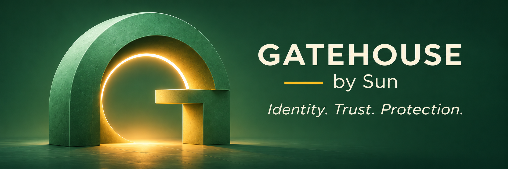

# ORYVA by Sun

**Identity. Trust. Protection.**

**An independent identity and security platform for connected applications.**

Bring authentication, authorization and user administration into a reusable platform that applications can integrate through ASP.NET Core and React/Next.js packages. ORYVA combines Keycloak-based identity with application-managed access and a Master, Admin and Viewer role model, giving SUN products a shared security foundation.

[Architecture](docs/architecture/OVERVIEW.md) · [Integration Guide](docs/architecture/INTEGRATION.md) · [Development Checklist](MASTER-CHECKLIST.md) · [Current Handoff](docs/roadmap/DEVELOPMENT-HANDOFF.md)

---

ORYVA is independently deployable. MarketPilot AI is its first planned consumer, not a dependency. Integration packages are under development and are not yet published.

**Historical status (2026-11-01; superseded for current frontend state by the [development handoff](docs/roadmap/DEVELOPMENT-HANDOFF.md) and [v1 authentication release gates](docs/roadmap/V1-AUTH-RELEASE-GATES.md)):** Backend v1 is **in progress**, not production-ready. Sole-master bootstrap, signed Keycloak JWT authorization, database-backed active admin/viewer access, guarded provisioning, activation, database-first revocation, atomic viewer reservation/preparation audits and PostgreSQL-backed cross-replica management write quotas are implemented and integration-tested. **Secure invitations, user-controlled credential enrollment, password change/recovery, complete lifecycle auditing, edge/login/recovery abuse protection, production Keycloak least-privilege configuration and final release gates remain outstanding.** Browser OIDC integration, React UI and consumer integration are separate unfinished workstreams.

## Implemented foundations
- Keycloak realm, PostgreSQL master reservation, and distributed provisioning lock.
- Idempotent, ownership-verified single-master provisioning and concurrency tests.
- Strict Keycloak JWT validation, realm master-role mapping, and database-backed active-master authorization.
- ASP.NET Core API with anonymous liveness and protected `/api/master/session`.
- CI integration tests against Keycloak and PostgreSQL, including real signed JWT requests.

## Brand
- [Brand guide](branding/BRAND-GUIDE.md)
- [Brand assets](branding/assets/) · [Archive](branding/archive/README.md)

## Documentation
- [Architecture overview](docs/architecture/OVERVIEW.md)
- [Active-master authorization](docs/architecture/ACTIVE-MASTER-AUTHORIZATION.md)
- [Protected API](docs/architecture/PROTECTED-API.md)
- [Security model](docs/architecture/SECURITY-MODEL.md)
- [Keycloak ownership-profile deployment gate](docs/operations/KEYCLOAK-USER-PROFILE.md)
- [Integration boundaries](docs/architecture/INTEGRATION.md)
- [Current development handoff](docs/roadmap/DEVELOPMENT-HANDOFF.md)
- [V1 authentication release gates](docs/roadmap/V1-AUTH-RELEASE-GATES.md)
- [Milestones](docs/roadmap/MILESTONES.md)
- [Master development checklist](MASTER-CHECKLIST.md)
- [Design system](docs/design-system/README.md)
- [Architecture decisions](docs/adr/)

Backend namespace: `Sun.Security.*`; frontend scope: `@sun-security/*`. Packages are not yet published. Changes use feature branches and reviewed PRs, not direct commits to main.
