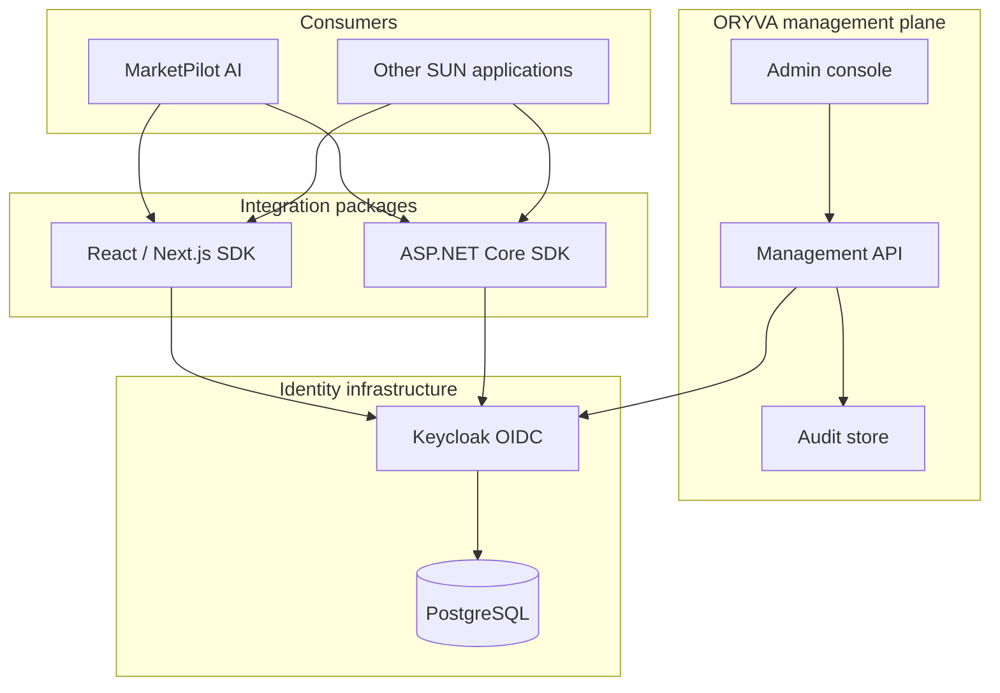

# ORYVA Architecture — v1

**Status: approved direction; not implemented.**

ORYVA comprises standards-based identity infrastructure, an optional management API and console, and reusable host integration libraries. The first consumer is MarketPilot AI; no MarketPilot-specific code belongs in ORYVA.



## Boundaries
- Keycloak: identity credentials, authentication, sessions and token issuance.
- ORYVA management API: privileged provisioning, controlled role assignments, auditing and optional centralized administration.
- ASP.NET Core SDK: token validation and local policy enforcement; do not call management API for every request.
- Frontend SDK: OIDC/session integration and accessible components; frontend permission checks are UX only.
- Consumer applications: business data and domain-specific administrative operations.

## Engineering approach
Modular monolith management API initially; independently deployable from consumers. .NET 10+ / ASP.NET Core 10+ / EF Core 10+ (where applicable), C# 14+; TypeScript; PostgreSQL only for ORYVA-owned state; Docker development. Prefer OIDC Authorization Code + PKCE; decide browser token/session strategy in an ADR before implementation.

## Planned monorepo
```text
src/backend/Sun.Security.{Abstractions,Authentication,Authorization,Identity,Auditing,AspNetCore,Management.Api}/
src/frontend/packages/{core,react,nextjs,ui,tokens}/
src/frontend/apps/{admin-console,playground}/
infrastructure/{docker,keycloak,postgres}/
tests/{unit,integration,security,e2e}/
examples/{aspnetcore-api,nextjs-app,fullstack-demo}/
docs/{architecture,adr,design-system,roadmap}/
.github/workflows/
```
These directories are planned; do not interpret this diagram as an inventory of implemented files.
